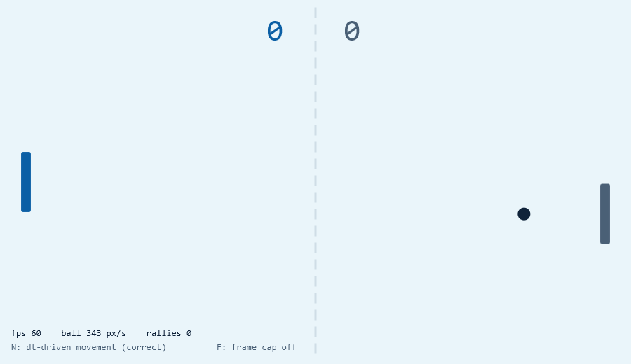
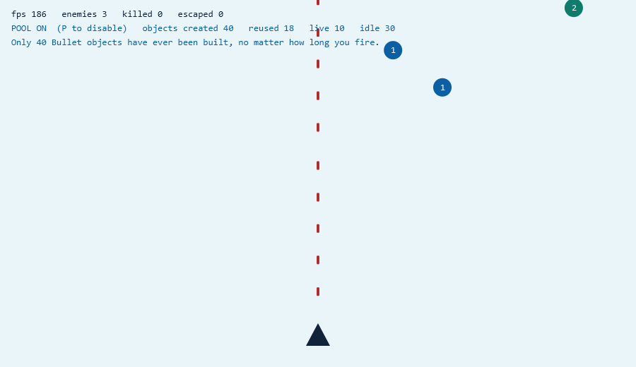
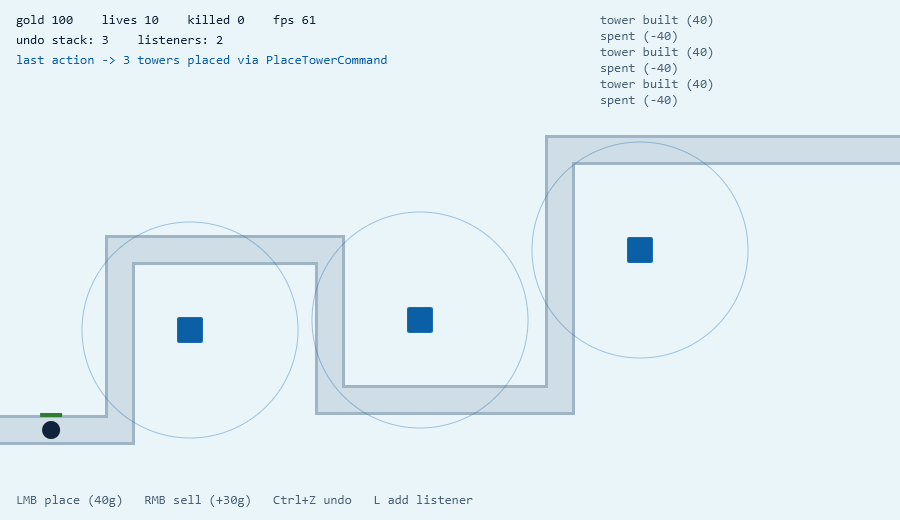
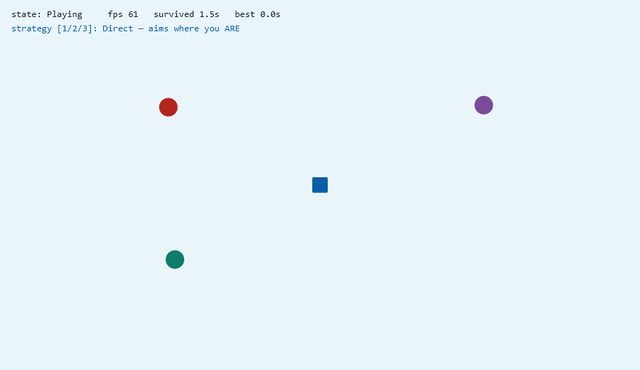
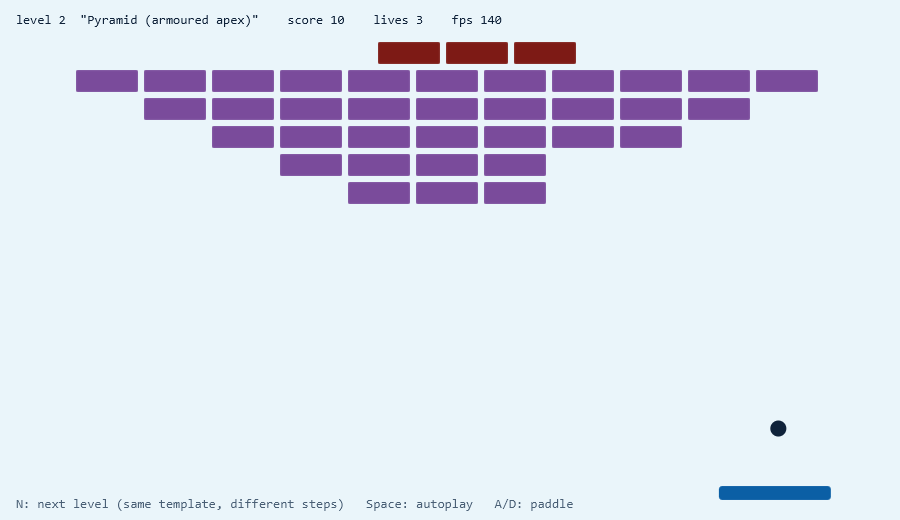
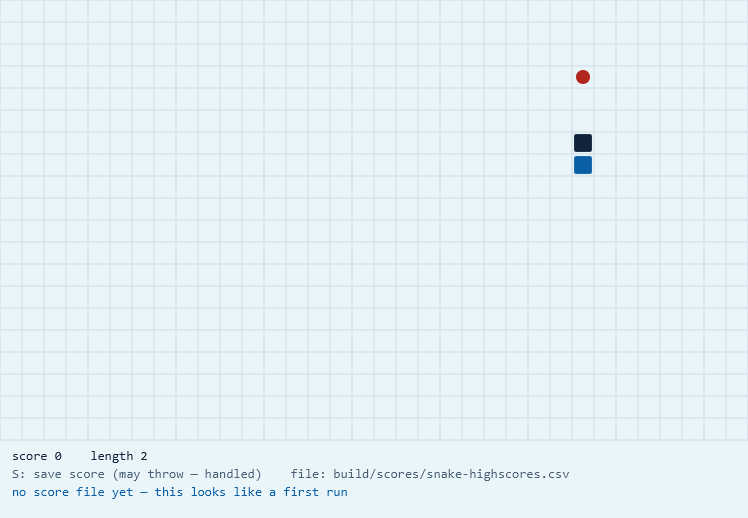

# The six games

One self-contained game per lecture session. Nothing is shared between them: if
you missed Session 2, you can still run and understand Session 4.

Every game is deliberately plain to look at. The graphics are simple so that the
*design decision* is the most interesting thing on the screen — and every game
prints its own internal state in the HUD, so you can watch the pattern working
rather than take our word for it.

| Session | Game | Patterns | Run |
|---|---|---|---|
| [1](#session-1--pong) | Pong | Game Loop, delta time, **Singleton** | `./gradlew runS01` |
| [2](#session-2--shooter) | Shooter | **Factory Method**, **Object Pool** | `./gradlew runS02` |
| [3](#session-3--tower-defense) | Tower Defense | **Command**, **Observer** | `./gradlew runS03` |
| [4](#session-4--chase) | Chase | **Strategy**, **State** | `./gradlew runS04` |
| [5](#session-5--breakout) | Breakout | **Template Method**, **Facade** | `./gradlew runS05` |
| [6](#session-6--snake) | Snake | File I/O, **exception design**, **unit testing** | `./gradlew runS06` |

New machine? Start with **[setup.md](setup.md)**.

---

## Session 1 — Pong

**Game Loop · delta time · Singleton**



Classic two-paddle Pong. You are the blue paddle on the left; the computer plays
the grey one on the right. The HUD along the bottom is the actual lesson: it
reports the frame rate, the ball's speed in **pixels per second**, and which of
the two movement modes is active.

**What it teaches.** A game loop is not a `while(true)` that moves things by a
fixed number of pixels. Move the ball "3 pixels per frame" and its real speed
becomes a property of the *hardware*: fast machine, fast ball. The fix is to
scale every movement by Δt, the time since the last frame. `AnimationTimer` hands
you a nanosecond timestamp; deriving Δt from consecutive timestamps is the first
thing this course asks you to do.

The Singleton arrives second, as the answer to a smaller question: the paddle,
the ball and the renderer all need the score, and passing a `ScoreManager`
through four constructors to reach the one place that uses it ("object
drilling") is worse than a single well-known instance. The class also shows what
a Singleton *costs* — global state is hard to reset and hard to test.

| Key | Effect |
|---|---|
| `↑` / `↓` or `W` / `S` | Move your paddle |
| **`N`** | Toggle naive (per-frame) vs Δt-driven movement |
| **`F`** | Toggle the frame-rate cap |
| `R` | Reset the score — through `ScoreManager.getInstance()` |

> **The moment to demo.** Press `N` to switch to naive movement, then press `F`
> to change the frame cap. The ball's speed visibly changes, and the `ball ___
> px/s` readout jumps — the same code, the same "3 pixels", a different game.
> Press `N` again and the speed holds steady no matter what `F` does.

**Read:** `ScoreManager.java` (the Singleton and its trade-offs) → `Ball.java`
(where Δt is applied) → `PongGame.java` (the loop itself).

---

## Session 2 — Shooter

**Factory Method · Object Pool**



A fixed-gun shooter: your ship is the dark triangle at the bottom, enemies
descend as numbered circles, and holding `Space` sends a stream of red bullets up
the screen. The top-left HUD counts every `Bullet` object the program has ever
allocated, how many were **reused**, and how many are live versus idle.

**What it teaches.** Firing continuously means creating and discarding thousands
of short-lived objects, and the garbage collector eventually makes that
visible as a stutter. An **object pool** keeps a fixed set of bullets alive and
hands them out instead of allocating: with pooling on, the counter stops at
around 40 no matter how long you hold the trigger.

The Factory Method half answers a different question: enemies come in several
kinds, and the spawner should not contain a growing `switch` over all of them.
Each enemy type supplies its own creation logic, so **adding an enemy is a new
class, not an edit to the spawner**.

| Key | Effect |
|---|---|
| `←` / `→` or `A` / `D` | Move your ship |
| `Space` (hold) | Fire |
| **`P`** | Toggle the object pool on / off |

> **The moment to demo.** Hold `Space` for ten seconds with `POOL ON` and watch
> `objects created` stay at 40 while `reused` climbs into the hundreds. Press
> `P` and hold `Space` again — `objects created` now rises without limit, one
> per shot, forever.

**Read:** `Pooling.java` (the generic `ObjectPool`, `Poolable` and factory
interface) → `Enemies.java` (the factories) → `ShooterGame.java`.

---

## Session 3 — Tower Defense

**Command · Observer**



Enemies walk the grey path from left to right; you spend gold to place blue
towers beside it, each with a visible range circle. The top-left HUD shows gold,
lives, the depth of the **undo stack** and the number of **listeners**; the
right-hand column is a live event log.

**What it teaches.** Every player action — build, sell — is an *object*
(`PlaceTowerCommand`, `SellTowerCommand`) rather than a method call. Because the
action is an object, it can be stored, and a stored action can be reversed. That
is where undo comes from, and `World` contains no undo logic at all.

The Observer half solves the coupling problem underneath the HUD, the log and
the sound effects: `World` should not know that any of them exist. It publishes
events; interested parties subscribe. Press `L` and a brand-new listener starts
receiving those events **while the game is running**, with nothing in `World` or
`Enemy` modified to allow it.

| Input | Effect |
|---|---|
| **Left click** | Place a tower (40 gold) — refused on the path, on another tower, or when broke |
| **Right click** | Sell the tower under the cursor (+30 gold) |
| **`Ctrl+Z`** | Undo the last action — the Command payoff |
| **`L`** | Subscribe another listener at runtime — the Observer payoff |

> **The moment to demo.** Place three towers, sell one, then press `Ctrl+Z`
> repeatedly. Each press names the action it is undoing and refunds the gold
> correctly. Then press `L` and watch `listeners:` increase and the log gain a
> second, independent voice.

**Read:** `Commands.java` (the command interface and `CommandHistory`) →
`Events.java` (the event bus) → `World.java` → `TowerDefenseGame.java`.

---

## Session 4 — Chase

**Strategy · State**



You are the blue square. Three coloured hunters pursue you, and you survive as
long as you can. The HUD names the current **state** (`Playing`) and the current
**strategy** — here, *"Direct — aims where you ARE"*.

**What it teaches.** All three hunters are the same class. What differs is the
algorithm each one is *given*: `Direct` heads at your current position,
`Predictive` aims where you will be, `Flanking` cuts you off. Press `1`, `2` or
`3` mid-chase and the behaviour changes instantly — a swapped object, not a
subclass, and not an `if` statement inside the hunter.

The State half is the game around the chase. Menu, Playing, Paused and GameOver
are **four classes**, each handling input itself. That is why `Space` starts a
round from the menu but does nothing while you are playing, and why `P` only
pauses mid-round. There is no `if (gameState == ...)` chain anywhere in the file
— the current state object decides what a key means.

| Key | Effect |
|---|---|
| `↑↓←→` or `WASD` | Move |
| **`1`** | Hunters use **Direct** — aims where you are |
| **`2`** | Hunters use **Predictive** — aims where you are going |
| **`3`** | Hunters use **Flanking** — cuts you off |
| `Space` | Start a round (from Menu or Game Over) |
| `P` | Pause / resume |
| `Esc` | Back to the menu |

> **The moment to demo.** Run in a straight line under strategy `1` and the
> hunters trail behind you forever. Press `2` without changing anything else —
> they start intercepting, and you get caught. Same objects, same loop, one
> swapped algorithm.

**Read:** `ChaseStrategy.java` (the three variants) → the four nested
`GameState` classes at the bottom of `ChaseGame.java`.

---

## Session 5 — Breakout

**Template Method · Facade**



Bat-and-ball brick breaker. The screenshot shows level 2, *"Pyramid (armoured
apex)"* — note the dark red armoured bricks at the top, which take extra hits.
Press `N` to jump to the next level.

**What it teaches.** Both levels are built by the **same `final` algorithm** in
the abstract `LevelLoader`: it fixes the *order* of construction — name the
level, lay out the bricks, set the ball speed, then optionally apply a twist.
Subclasses supply only the individual steps. `Classic` ignores the twist hook;
`Pyramid` overrides it to armour its apex. The parent is in charge and calls
down into the child — *"don't call us, we'll call you"*.

The Facade is `GameEngine`. Physics, level loading, scoring and lives sit behind
a handful of plain calls, so the game class says `engine.nextLevel()` and knows
nothing about what that involves.

| Key | Effect |
|---|---|
| `←` / `→` or `A` / `D` | Move the paddle |
| **`N`** | Next level — same template, different steps |
| **`Space`** | Toggle autoplay (the paddle tracks the ball) |

> **The moment to demo.** Press `N` and point out that the two levels share
> every line of the loading algorithm; only three small methods differ. Then add
> a third level live — it is one new class in `Levels.java` and **no other edit
> anywhere**.

**Read:** `LevelLoader.java` (the template method and its hooks) →
`Levels.java` (`Classic`, `Pyramid`) → `GameEngine.java` (the facade).

---

## Session 6 — Snake

**File I/O · exception design · unit testing**



Grid-based Snake: eat the red food, grow, do not hit yourself. The bottom of the
screen is where this session's real subject lives — it names the high-score file
and reports its condition. In the screenshot it says *"no score file yet — this
looks like a first run"*, which is a normal situation, not an error.

**What it teaches.** Two operations on the same file are treated deliberately
differently:

- **`load()` never throws.** A missing file yields an empty table. A corrupted
  line is skipped and reported as a warning in the HUD. Failing to read an
  optional high-score list is not worth crashing a game over.
- **`save()` throws a checked `ScoreStoreException`.** If the player's score
  cannot be written, the caller *must* decide what to do about it. Silence would
  be a lie.

That asymmetry is the lesson: exceptions are a design decision about who is
responsible, not a mechanical wrapper around risky code.

This is also the testing session, and it works only because of one earlier
choice — **`SnakeLogic` contains no JavaFX at all**. The rules are a plain Java
object, so `SnakeLogicTest` can test growth, collisions and scoring without ever
opening a window. Testability is a consequence of separating rules from
drawing; you cannot bolt it on afterwards.

| Key | Effect |
|---|---|
| `↑` / `W` | Turn up |
| `↓` / **`Shift+S`** | Turn down |
| `←` / `→` or `A` / `D` | Turn left / right |
| `Space` | New game |
| **`S`** | Save the score — the call that may throw |

> ⚠️ Plain **`S` saves**; use `Shift+S` or `↓` to steer downwards. This is the
> one control in the six games that surprises people used to WASD.

> **The moment to demo.** Press `S` to create
> `build/scores/snake-highscores.csv`. Open it, corrupt a line by hand, and
> restart the game. It loads the surviving entries and explains the damage in
> the HUD — it never shows a stack trace. Then run `./gradlew test` to show the
> same rules verified without a window.

**Read:** `HighScoreRepository.java` (the load/save asymmetry) →
`SnakeLogic.java` (no JavaFX) → `SnakeLogicTest.java`.

---

## Regenerating these screenshots

Every image here is produced by the project itself, not captured by hand:

```bash
./gradlew shotAll        # renders all six games to build/shots/*.png and exits
```

Copy the results over `docs/images/` to refresh this page. The same task is the
quickest check that all six games still work after a change.
